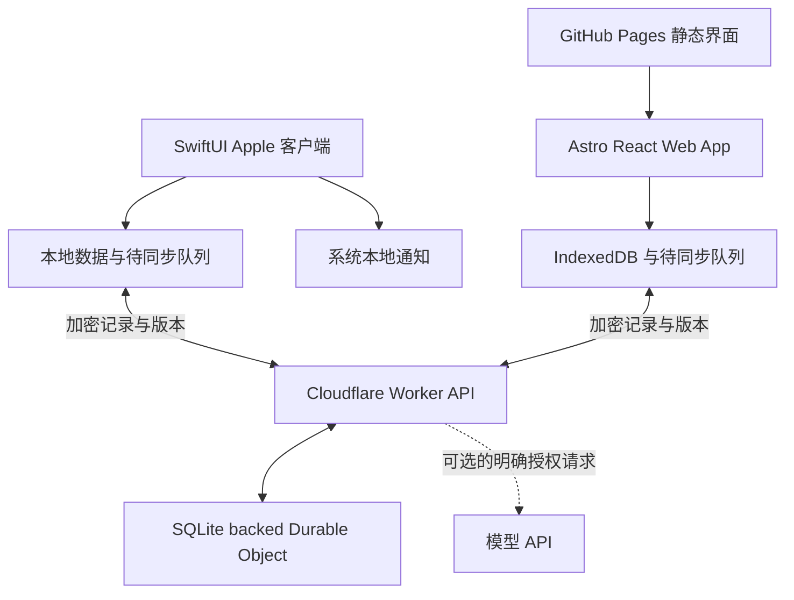

# Reminder Board Apple 适配与开发计划

更新日期：2026-10-23

状态：设计草案，供 Mac 上继续设计和实现

开发分支：`dev-reminder-board-apple`

起点：`9f7e321`，现有 Astro 个人网站及 Cloudflare checkbox sync

## 目标与产品原则

将现有 Reminder Board 升级为日常可直接更新的个人提醒工具：Apple 设备提供原生快速入口，其他设备使用完整 Web App，两端共享同一份任务数据。新增任务不再需要修改 YAML、运行加密命令、提交 Git 和部署网站。

核心体验是“想到就记、打开就懂、完成就消失”。它服务于个人研究、项目和日常活动，不扩展为复杂项目管理平台。

- 一句话即可记录；所属工作、日期和备注允许之后补充。
- 用户决定任务粒度，AI 不自行拆分出大量子任务、标签或计划。
- 首页突出当前可行动的事项；已完成任务只在 Work Context 中保留。
- 今天关注与截止日期分开：没有 deadline 的研究也可以成为今天的重点。
- 操作先在本地生效，再同步；失败时清楚显示待同步状态。
- 保留深色与绿色点缀，Apple 端使用原生控件、系统字体和无障碍支持。
- 第一版不做团队协作、百分比进度条、复杂优先级体系或自动发送邮件。

## 现有实现与改造边界

| 部分 | 当前状态 | 目标变化 |
| --- | --- | --- |
| 前端 | Astro 4、React 18、TypeScript，GitHub Pages 发布 | 保留网站，增强 `/progress` 的直接编辑能力 |
| 任务内容 | 本地私有 YAML，加密后提交静态 JSON | 内容通过 API 保存，Git 只管理应用代码 |
| 完成状态 | localStorage 与 Worker + KV 同步 | 纳入统一任务记录和版本控制 |
| 解锁 | 输入完整 challenge response，在浏览器解密 | 兼容现有数据；Apple 可用生物识别保护本机密钥 |
| Apple 入口 | 浏览器页面 | SwiftUI 轻客户端、小组件、快捷入口 |
| 提醒 | 页面中的日期提示 | 可选本地通知，之后增加跨设备通知协调 |

接续开发时重点阅读这些文件：

- [ProgressVault.tsx](../src/components/ProgressVault.tsx)：解锁、任务展示、勾选和同步流程。
- [progress.ts](../src/lib/progress.ts)：当前数据类型。
- [progress-sync.ts](../src/lib/progress-sync.ts)：同步凭据、加解密及本地状态。
- [Worker](../progress-sync-worker/src/index.js)：现有 checkbox API。
- [Wrangler 配置](../progress-sync-worker/wrangler.jsonc)：生产资源绑定。
- [progress-vault.mjs](../scripts/progress-vault.mjs)：私有 YAML 校验与加解密。
- [README](../README.md#progress-vault)：现有维护流程。

本分支首先保存设计文档。下文的 API、原生目录、新数据结构和开发环境均为拟议方案，并未实现。

## 用户体验

### 三个主要页面

| 页面 | 展示内容 | 主要动作 |
| --- | --- | --- |
| 今天 | 主动选择的 1–3 件关注事项，以及即将到期的任务 | 完成、移出今天、改日期 |
| 收件箱 | 尚未归类的想法与任务 | 归入工作、补充日期、删除 |
| 工作 | 活动或项目，以及各自的下一步和历史 | 添加任务、查看背景、归档 |

“等待中”和“稍后再看”作为轻量筛选，不必占据新的主导航。等待视频发布或对方回复的事项应有再次查看时间，而不必设置虚构的完成期限。

任务卡主要显示任务名称、所属工作、日期。完成后立即从主要列表移除，提供撤销；在 Work Context 中仍可查看和恢复。已有下一步时，可以轻量提示是否将其设为今天关注。

### 不同设备上的入口

| 场景 | 入口与行为 | 优先级 |
| --- | --- | --- |
| 随手记录 | iPhone 快速输入，只要求任务标题 | 第一版 |
| 随时查看 | iPhone 主屏幕小组件展示今天关注 | 第一版 |
| 勾选完成 | 小组件交互，在本地记录后同步 | 第一版 |
| 阅读时收藏行动 | 分享扩展接收网页标题、URL、选中文字 | 后续 |
| 快捷操作 | App Intents 暴露新增、完成、查看今天等动作 | 后续 |
| Mac 工作中记录 | 菜单栏入口与全局快捷键 | 后续 |
| 非 Apple 设备 | Web App 完整管理任务 | 第一版 |

Siri、快捷指令和操作按钮使用明确实现的 App Intents。系统入口与自由文本 AI 解析是两种能力，不把接入 Siri 当作任意自然语言理解已经完成。具体系统版本和支持的设备在 Mac 原型阶段确定。[Apple App Intents](https://developer.apple.com/documentation/appintents)

小组件可以通过 App Intents 完成勾选，但后台刷新由系统调度，不承诺始终实时显示。展示失败时保留最后同步时间，并提供打开应用的路径。[Apple 交互式小组件](https://developer.apple.com/documentation/widgetkit/adding-interactivity-to-widgets-and-live-activities)

## 运行架构



Apple 与 Web 使用同一个任务后端。SwiftUI 可以复用部分 Apple 平台代码，但需要分别适配 iPhone、iPad 和 Mac；React 界面不直接复用于 SwiftUI。[Apple SwiftUI](https://developer.apple.com/documentation/technologyoverviews/swiftui)

### 存储选择

建议新任务数据使用 SQLite-backed Durable Object，个人 board 由一个对象协调更新。现有 KV 保留给旧版兼容和迁移，不继续作为可编辑任务的主要存储。

KV 是最终一致存储，不同网络位置可能要 60 秒甚至更久才能看到更新，也不适合原子读改写；Durable Object 存储支持事务与强一致性。迁移的目的在于防止多设备修改互相覆盖，并非个人数据量大。[KV 一致性](https://developers.cloudflare.com/kv/concepts/how-kv-works/)、[Durable Object 存储](https://developers.cloudflare.com/durable-objects/api/sqlite-storage-api/)

数据库强一致不能自动解决离线编辑冲突。客户端仍需使用服务端版本号、幂等操作 ID 和冲突提示。

CloudKit 支持通过 CloudKit JS 提供 Web 访问，是可选替代方案。当前推荐延续 Cloudflare，以复用现有后端并统一非 Apple 设备访问。第一版不同时维护 CloudKit 和 Cloudflare 两套任务源。[CloudKit JS](https://developer.apple.com/documentation/cloudkitjs)

### 拟议数据模型

界面保持精简，底层只增加同步与提醒所需字段。

| 实体 | 内容字段建议 |
| --- | --- |
| Work | 稳定 ID、标题、简短背景、归档状态 |
| Task | 稳定 ID、可空 workId、标题、备注、open/waiting/done 状态 |
| 时间安排 | dueDate、remindAt、reviewAt、focusDate、completedAt，均按需填写 |
| 关联来源 | 可选 sourceUrl、选中文字 |
| 同步记录外壳 | 随机记录 ID、schemaVersion、服务端 revision、密文、删除标记 |
| 本地操作 | operationId、baseRevision、待提交修改、同步结果 |

内容字段在客户端加密；云端版本控制只依赖记录外壳。避免默认上传明文标题、项目关联或截止日期。若以后需要服务端定时提醒，再明确允许云端读取哪些提醒元数据。

日期语义需要跨平台一致：dueDate 是用户本地日历日期；提醒时间保存为确定时刻，并保留时区语义。用 Europe/Berlin 的夏令时切换验证行为。现有日常阅读安排在迁移时保留，自动生成每日任务属于后续单独设计。

### 拟议同步协议

- 获取记录快照或从游标开始获取变更。
- 提交操作时携带 operationId、recordId 和 baseRevision。
- 服务端在事务中校验版本、保存密文、增加 revision 并记录幂等结果。
- 版本过期返回冲突，客户端获取最新数据后在本地解密、比较并让用户决定。
- 网络重试不能重复创建任务；离线删除使用 tombstone，防止旧设备恢复已删除内容。
- 登录、重新进入前台和网络恢复时触发同步；在线即时更新可以后续加入。
- UI 区分“本地已保存”“同步中”“已同步”“需要处理冲突”。

API 路径可在原型阶段确定，例如 `/v2/records`、`/v2/changes`、`/v2/operations`。这只是接口草案，不修改现有 `/state` 的含义。认证、存储限额和请求大小限制需随新接口一起实现。

## 加密与设备解锁

保留“任务内容由客户端解密”的原则。身份验证与内容加密是两件事，应分别设计；API 必须验证凭据，不能把 CORS 当作身份验证。

现有静态内容使用 PBKDF2 与 AES-GCM，checkbox sync 另外派生认证凭据和加密密钥。新版需保留读取旧格式的能力，并为新格式建立 Swift CryptoKit 与浏览器 Web Crypto 的互通测试，包括 Unicode 规范化、AAD、nonce、编码与错误密钥行为。

推荐评估独立随机数据密钥、密码包装和设备授权机制。是否在第一版引入，需先完成恢复流程和小组件密钥访问原型。不得只为快速开发把旧的同步 bearer credential 当成永久设备管理方案。

### Apple 解锁与小组件的取舍

- 首次导入或配对需要用户提供原有解锁信息。
- Keychain 保护设备凭据和本地密钥；Face ID 或 Touch ID 允许用户释放受保护密钥。
- 生物识别不替代云端认证，也不解决丢失所有密钥后的数据恢复。
- 小组件与分享扩展需要明确 App Group 数据共享和 Keychain 访问策略。
- 要求每次生物识别才能释放的密钥，不能同时假定扩展可以无感后台解密。

建议首个版本默认锁屏隐藏任务标题。用户可以选择允许组件读取最小展示缓存；若锁定时无法加密完成操作，可暂存在受设备数据保护的操作队列，待解锁后同步，并明确显示本地待同步。缓存范围和系统保护等级需在真机上验证。

备份应支持导出加密数据，并通过导入演练验证恢复。恢复密钥或密码不上传 Git，不写入文档、日志或测试夹具。

## 提醒与 AI 的边界

### 本地通知优先

任务在 Apple 端解密后，注册系统本地通知。已安排的通知可以在应用未运行时由系统投递，但仍受通知授权和设备设置影响。[Apple 本地通知](https://developer.apple.com/documentation/usernotifications/scheduling-a-notification-locally-from-your-app)

Web 上改期或完成任务后，Apple 设备需要收到更新才能取消旧通知。后台执行不是随时可用的：第一版在打开应用和同步时重新协调通知，提示最后同步时间；后续可增加 APNs 唤醒或推送，但仍不能承诺即时取消。

允许选择主要提醒设备，减少多台设备同时提醒。首次只实现单次提醒、完成、稍后提醒；周回顾与自动摘要后续再加。

如果要求关闭 Web App 后仍收到提醒，需要服务端定时调度、推送订阅和 Web Push。iOS/iPadOS 的 Web Push 支持主屏幕 Web App；原生端使用自己的通知机制。[Apple Web Push](https://developer.apple.com/documentation/usernotifications/sending-web-push-notifications-in-web-apps-and-browsers)

若用 Cloudflare Cron，注意其时间表使用 UTC；应单独处理用户时区和夏令时。[Cloudflare Cron](https://developers.cloudflare.com/workers/configuration/cron-triggers/)

### AI 只生成待确认修改

自然语言输入可选接入模型 API。用户提交的文字及必要上下文会在请求中对 Worker 和模型服务可见，应说明发送范围；静态密文存储不意味着该 AI 请求仍然端到端保密。

模型返回结构化的修改预览，客户端校验后由用户确认保存。它不能直接执行删除、发邮件、无限拆分任务，也不访问解锁密钥。模型 API key 存在 Worker Secret 中，设置请求限额和使用预算。手动编辑、同步和提醒不依赖 AI。

## 迁移方案

1. 备份当前加密 JSON、现有 checkbox 状态及本地私有 YAML；避免覆盖唯一副本。
2. 在已解锁客户端读取旧数据，合并有效的本地及云端完成状态，展示数量和迁移预览。
3. 迁移保留现有 work/task ID 映射；新存储外壳可使用随机 ID，并保留迁移对应关系。
4. 通过新 API 导入密文，使用 migrationId 防止重复导入。
5. 在第二台设备验证标题、所属工作、完成状态、日期以及恢复能力。
6. 验证后将新 API 设为任务内容的唯一写入来源。旧客户端需提示升级或改为只读，避免分裂成两份数据。
7. 旧静态加密文件和 KV 暂时保留用于回退；回退前导出新版新增内容，避免恢复旧快照导致数据丢失。

新建 Mac checkout 不包含被 Git 忽略的 `data/progress.private.yml` 或本机 OAuth 配置。可用旧解锁信息恢复仓库中的加密快照；最新完成状态还需要从旧同步服务读取，不能只迁移静态文件。

## 分阶段开发与验收

| 阶段 | 交付内容 | 验收标准 |
| --- | --- | --- |
| 0 设计与原型 | 三页面草图；确认设备、系统最低版本、密钥策略与分发方式 | 能演示快速记录、完成、改期、等待四条流程；确定原生第一版范围 |
| 1 共享后端 | 独立开发 Worker、Durable Object、版本协议、认证、导入导出 | 两客户端并发编辑不静默覆盖；重复请求幂等；拒绝未授权读写；旧数据可迁移 |
| 2 Web 编辑 | 新增编辑、收件箱、今天关注、等待、IndexedDB 队列 | 全流程无需部署；离线修改可恢复；完成仅在 Work Context 保留；刷新不丢数据 |
| 3 Apple 核心 | SwiftUI iPhone App、本地存储、Keychain、解锁与共享 API | 真机和 Web 双向编辑；离线恢复；生物识别取消与设备丢失恢复流程可解释 |
| 4 Apple 日常入口 | WidgetKit、本地通知、完成与稍后提醒 | 小组件完成可追踪同步；通知改期取消正确；锁屏不意外泄露标题 |
| 5 按使用反馈扩展 | 分享扩展、App Intents、Mac 菜单栏、快捷键、iPad 适配 | 从 Safari 和 Mac 输入能够稳定进入同一个收件箱 |
| 6 可选智能能力 | 自然语言修改预览、周回顾、跨平台推送 | AI 不越权修改；失败能手动操作；推送不会多设备重复轰炸 |

阶段 1–4 是目标第一版。阶段 0 可提前做 iPhone 小组件与密钥访问的小原型，避免把原生限制推迟到最后才发现。各阶段完成后再决定下一阶段，不预设全部功能都必须实现。

### 关键验证场景

- Web 与 iPhone 同时修改同一任务，不以设备时钟静默决定胜负。
- 离线新建、编辑、完成、删除后重连，无重复任务或已删除内容复活。
- Swift 与 JavaScript 使用相同非生产夹具互相加解密。
- 未授权请求、过期设备凭据、撤销设备无法访问任务。
- 日期经过 Europe/Berlin 夏令时切换后保持预期语义。
- 小组件缓存过期、设备锁定、密钥不可用、通知被拒绝时都有合理表现。
- 原有任务及完成状态迁移后数量一致，旧版不能继续形成新的写入源。
- 新设备从加密备份恢复成功；所有日志与 Git diff 不包含真实任务明文或凭据。

## Mac 接续开发

### 获取此分支

已有仓库：

```bash
git fetch origin
git switch --track origin/dev-reminder-board-apple
```

如果本地已经有同名分支，直接 `git switch dev-reminder-board-apple`，再使用 `git pull --ff-only`。新 checkout 可以使用：

```bash
git clone --branch dev-reminder-board-apple git@github.com:lialittis/astro-portfolio.git
cd astro-portfolio
```

### Web 与 Worker 环境

建议先用 Node.js 22 和项目指定的 pnpm 9.2.0，分别安装根目录与 Worker 目录的锁定依赖；后续升级单独提交。现有网站 CI 使用 Node.js 20，应检查与本地及 Worker 的版本差异。

```bash
pnpm install --frozen-lockfile
pnpm dev
```

另一个终端配置 Worker 本地开发：

```bash
cd progress-sync-worker
pnpm install --frozen-lockfile
pnpm exec wrangler dev
```

Wrangler 本地启动本身不会完成前端联调：当前前端 URL 指向生产 Worker，新版开发首先要增加环境配置，使本地前端连接本地 Worker。认证值通过被忽略的 `.dev.vars` 提供，仅使用开发凭据和虚构任务。部署开发后端之前，创建独立的 Worker 名称、存储绑定和 Secret，禁止沿用生产写入目标。

现有可执行检查：

```bash
pnpm test:progress
pnpm test:progress-sync
pnpm build
```

`pnpm progress:validate` 需要本机私有 YAML。新 checkout 没有它时不要为通过检查而把个人明文加入仓库。

### Apple 环境

需要 Mac、兼容的 Xcode、Apple 账户和用于通知、生物识别、小组件测试的真实 iPhone。Xcode 的具体版本和 deployment target 在阶段 0 根据实际设备确定。[Apple SwiftUI 开发环境](https://developer.apple.com/tutorials/develop-in-swift/welcome-to-swiftui)

免费 Personal Team 可以进行真机测试，但 provisioning profile 七天过期，需要重新构建安装。长期自用应选择合适的 Developer Program 与签名分发方式；TestFlight 的构建也有期限，不能当作永久安装方案。[Apple 账户说明](https://developer.apple.com/help/account/basics/about-your-developer-account)

建议后续在同仓库新增以下目录；当前文档提交不会创建原生工程：

```text
apple/ReminderBoard/              SwiftUI 工程、应用与扩展 targets
contracts/reminder-board/        API、schema、跨语言加密测试夹具
docs/                           设计、迁移与开发记录
```

第一轮在 Mac 上依次完成：确认设备与签名方式；画三页面草图；做快速录入和 WidgetKit 原型；验证 Keychain 与扩展访问限制；再确定同步协议和新版加密格式。可先用虚构数据，不需要立即连接生产任务。

## 分支与发布约定

本分支保存设计和后续开发，按阶段提交。既有 GitHub Pages 工作流发布 `main`，推送此分支不会把开发版替换到生产网站。Worker 发布是独立操作，开发阶段只部署独立环境。

文档与代码可以提交；真实任务明文、challenge response、认证 hash、Cloudflare OAuth 配置、Apple 签名私钥和模型 API key 均留在本机或相应 Secret 管理系统中。文档位于 `docs/`，不会生成网站页面，但仍随 Git 仓库共享。

上线前必须完成新旧客户端切换、备份恢复和跨设备验证，再分别发布后端与前端。Apple 应用与 Web 可按各自节奏发布，但 API 和密文格式需要明确兼容版本。
